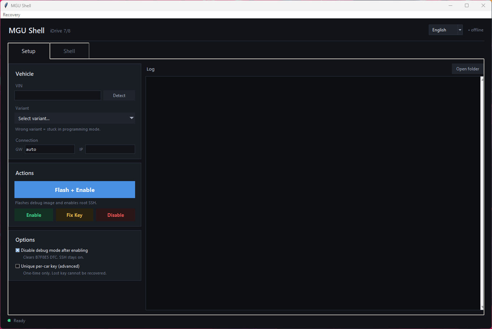
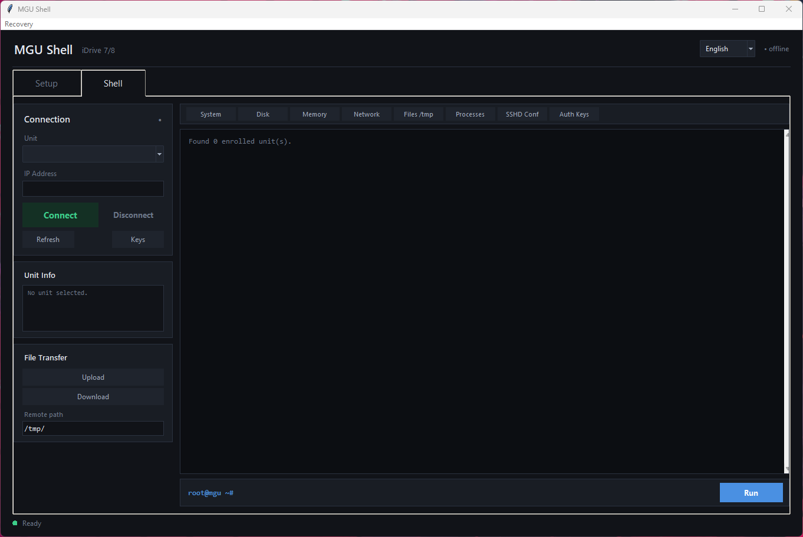

# MGU Shell

Enable **root SSH** on BMW MGU head units (iDrive 7 / ID7, ID8-BDC3, ID8-BCP)
over the car's **ENET** diagnostic interface. Flash the debug image, enroll the
SSH identity, and keep SSH running with debug mode off — no `B7F8E5` DTC.

Run it once per head unit. SSH stays on permanently after that.





## Requirements

- **Python 3.9+** (not needed for the prebuilt `.exe`)
- **OpenSSH client** on `PATH` (`ssh -V` to check)
- **ENET cable**, ignition on
- **Windows:** run as Administrator for `169.254.x.x` link-local addressing

## Install

```
pip install -r requirements.txt
```

## Usage

```
python gui.py
```

### Setup tab

- **Flash + Enable** — one-time: flashes debug image, enrolls SSH, makes it persistent, turns debug off.
- **Enable** — repair only: re-opens SSH on an already-flashed unit (no flash).
- **Fix Key** — re-flashes with our key for units that refuse login after enrollment.
- **Disable** — reverts to stock.

### Shell tab

Built-in SSH terminal. Connects to enrolled units using the keys saved during setup. Includes quick-action buttons, command history, and file transfer (upload/download).

### Command line

```
python ssh_enable.py flash --vin <VIN> --persist   # one-time setup
python ssh_enable.py enable                        # repair (no flash)
python ssh_enable.py status                        # read-only check
python ssh_enable.py disable                       # revert to stock
```

## Back up your coding before flashing

`flash` reprograms the head unit and **wipes its coding / CAFD definitions**.
Back up with BimmerCode or E-Sys before flashing. Restore afterwards if
settings are reset. Digital Key pairings are also lost and must be re-paired.

## SSH keys

Keys are saved to `data/enrollments/<VIN>/` in all formats:

```
id_rsa             OpenSSH private key
id_rsa.pkcs1.pem   PKCS#1 PEM
id_rsa.pkcs8.pem   PKCS#8 PEM
id_rsa.ppk         PuTTY / WinSCP
id_rsa.pub         OpenSSH public
connect.txt        IP + ssh command
```

Connect after setup:
```
ssh -i data/enrollments/<VIN>/id_rsa root@<ip>
```

## License

Released into the **public domain** under [The Unlicense](LICENSE).
